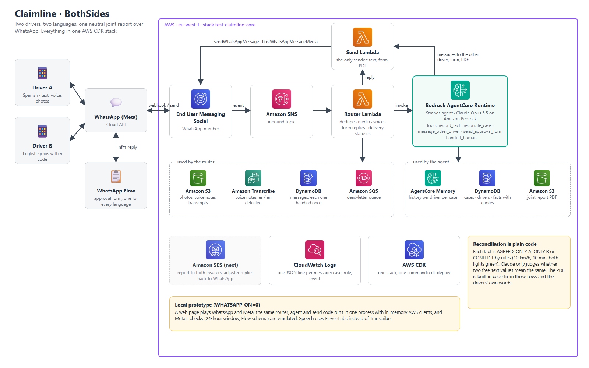

# Claimline · BothSides

**Two drivers. Two languages. One report.** After a car crash, both drivers message the same WhatsApp number, each in their own language, by text or voice notes. Claimline's agent collects each version separately, compares them in plain code, asks only about what doesn't match without ever saying who is at fault, and sends both drivers a neutral joint report to approve in a WhatsApp Flow. When both approve, each receives the report as a PDF.

Built for the AWS CDS Agentic AI Partner Hackathon (October 2026).



- **Try it:** [JUDGE_TEST.md](JUDGE_TEST.md). The local WhatsApp prototype runs the deployed code in a browser, with no phone needed.
- **What is ours:** [ORIGINAL_WORK.md](ORIGINAL_WORK.md).

## How a case runs

1. **Driver A** messages the insurer's WhatsApp number. The agent says it is an AI assistant and asks about injuries first. If anyone is hurt, it gives the emergency number and hands the case to a person.
2. Driver A gets a link and a code, `JOIN XXXXXX`, to show **driver B**. B joins from their own phone, in their own language.
3. Each driver tells what happened, by text, voice notes or photos. Every fact is saved with the driver's own words as evidence. Plates are asked for in writing, because speech recognition can mishear them.
4. Once both versions are in, `reconcile_case` compares them **in plain code**: each fact is AGREED, ONLY_A, ONLY_B or CONFLICT. There are rules for speeds within 10 km/h and times within 10 minutes, and a conflict when both drivers say their own light was green. Claude only judges whether two free-text values mean the same thing, never numbers or times.
5. The agent asks each driver about each conflict once, in neutral words, and tells the other driver through their own chat.
6. Each driver gets a **WhatsApp Flow** with the draft: what both agree on, what only one said, and what is disputed. Approving means "this records what each of us said", not "I accept the other version". A driver's comment goes into the report in their own words. Two rejections with no correction hand the case to a person.
7. When the second driver approves, the joint report is **built in code as a PDF**, stored in S3 and sent to both drivers as a WhatsApp document, ready to forward to their insurer.

It also handles a third party, such as a pedestrian, cyclist or animal, that only one driver saw: what they did and why a driver braked are compared like any other fact, and nobody is blamed.

## How we use WhatsApp (AWS End User Messaging Social)

WhatsApp is the only channel the drivers use, and it runs entirely through **AWS End User Messaging Social**. There is no WhatsApp Web, no unofficial library and no third-party gateway.

| What | EUM Social API | Where |
|---|---|---|
| Inbound messages, voice notes, photos, Flow answers and delivery statuses arrive as webhook events on an SNS topic | Event destination → Amazon SNS | `lambdas/router/handler.py` |
| Voice notes and photos are copied to S3 | `GetWhatsAppMessageMedia` | router |
| Every reply, every message to the other driver, and the review form | `SendWhatsAppMessage` (text and interactive `flow` messages) | `lambdas/send/handler.py` |
| The report PDF, uploaded from S3 and sent as a document | `PostWhatsAppMessageMedia` + `SendWhatsAppMessage` (`document`) | send |
| The approval form: one static Flow whose texts travel in each message, so it serves every language | `CreateWhatsAppFlow`, `UpdateWhatsAppFlowAssets`, `PublishWhatsAppFlow` | `flows/approval.json`, `scripts/flow.py` |

BothSides needs no message templates: both drivers write first, so every message is inside WhatsApp's 24-hour service window.

## AWS services

| Service | Role |
|---|---|
| Amazon Bedrock AgentCore Runtime | Hosts the Strands agent; one session per driver |
| Amazon Bedrock AgentCore Memory | Conversation history per driver per case |
| Amazon Bedrock (Claude Opus 5.5) | The agent, and the meaning judge in reconciliation |
| AWS End User Messaging Social | WhatsApp, including Flows and media |
| Amazon Transcribe | Voice notes, Spanish or English detected |
| AWS Lambda | Router (inbound) and send (the only outbound path) |
| Amazon SNS, Amazon SQS | Inbound events; dead-letter queue for the router |
| Amazon DynamoDB | Cases, drivers, facts with evidence, processed message ids |
| Amazon S3 | Photos, voice notes, transcripts, report PDFs |
| Amazon CloudWatch Logs | One JSON line per message: case, role, event; delivery statuses |
| AWS CDK | The whole stack, deployed with one command |

## Deploy

**Prerequisites:**
- An AWS account with the CDK bootstrapped in the target region (`cdk bootstrap`).
- Python 3.12 and Node.js (for the CDK CLI: `npm install -g aws-cdk`).
- Model access in Amazon Bedrock to Claude Opus 5.5 (inference profile `eu.anthropic.claude-opus-5-5`). Another model is set in `infra/agent_stack.py` (`MODEL_ID`).
- A WhatsApp Business number linked in AWS End User Messaging Social. Its id looks like `phone-number-id-…`.

**One command, after installing the dependencies:**

```powershell
python -m venv .venv
.venv\Scripts\pip install -r requirements.txt
$env:CLAIMLINE_ACCOUNT = "123456789012"     # your account id; region via CLAIMLINE_REGION (default eu-west-1)
cdk deploy --all --profile your-profile -c wabaPhoneNumberId=phone-number-id-xxxxxxxx -c permissionsBoundary=
```

`cdk deploy` builds the agent bundle for Linux ARM64 with `uv`, without Docker.

**After the first deploy:**
1. In End User Messaging Social, set the WhatsApp event destination to the SNS topic `test-claimline-inbound`.
2. Create the approval Flow with `python scripts/flow.py`, add `--publish` to publish it, and put its id in `APPROVAL_FLOW_ID` in `infra/agent_stack.py`. `APPROVAL_FLOW_MODE` is `draft` until the Flow is published.

Defaults in `cdk.json` are for our shared hackathon account: profile `test`, and the permissions boundary `test-claimline-deploy` that account requires. `-c permissionsBoundary=` turns the boundary off. Resource names come from `infra/naming.py`; that account requires the `test-` prefix and the tag `Owner = test`.

**Settings:**

| Setting | Where | Default |
|---|---|---|
| `wabaPhoneNumberId` | `-c` context | none; required to send |
| `permissionsBoundary` | `-c` context | `test-claimline-deploy` |
| `CLAIMLINE_ACCOUNT`, `CLAIMLINE_REGION` | environment, at deploy | our account, `eu-west-1` |
| `MODEL_ID`, `APPROVAL_FLOW_ID`, `APPROVAL_FLOW_MODE`, `WHATSAPP_ON` | `infra/agent_stack.py` → runtime environment | Opus 5.5, our Flow, `draft`, `1` |
| `ELEVENLABS_API_KEY` | environment or `~/.claimline/env`; local prototype only | none, which means text only |

## Cost

Everything is serverless and pay per use. With no traffic, the only running cost is S3 storage and CloudWatch Logs.

Per case, the main cost is Claude on Bedrock. Measured on the full scripted case in `scripts/simulate_voice.py` (17 messages from the two drivers, mostly voice notes, a conflict, both approvals and the PDF): about **247,000 input and 10,000 output tokens** for the agent turns, plus a few short calls to the meaning judge. Multiply by the current Bedrock price of the model you use; most input is the prompt and history sent again on each turn.

| Item | Charged per |
|---|---|
| Bedrock (Claude Opus 5.5) | Input and output tokens; Claude Sonnet 5.5 is cheaper |
| AgentCore Runtime and Memory | Active session time and memory events |
| Amazon Transcribe | Seconds of audio, about 5 to 30 seconds per voice note |
| Lambda, DynamoDB (on demand), SNS, SQS, S3 | Requests; hundreds per case |
| WhatsApp | Meta's pricing; BothSides only sends replies inside the 24-hour service window |

## Local WhatsApp prototype (`WHATSAPP_ON=0`)

`python -m pipeline.server` serves http://localhost:8765. The page's two phones play WhatsApp and Meta, and everything after Meta is the deployed code, run in one process:

1. A phone's message becomes the webhook entry Meta posts. SNS hands it to `lambdas/router/handler.py` unchanged: dedupe, media copy, transcription, the AgentCore payload, Flow replies and delivery statuses.
2. The agent runs with the same prompts, tools and reconciliation, on real Claude.
3. `lambdas/send/handler.py`, unchanged, builds each Cloud API message, including the report PDF.
4. The emulated Meta checks each message before the page shows it: the 24-hour window, text and button limits, and the review form against `flows/approval.json` (screen, data fields and types). The page opens the form from that same Flow definition and answers with the `nfm_reply` WhatsApp sends.

Only the AWS clients are swapped (`pipeline/fake_aws.py`):

| Service | Deployed | Local |
|---|---|---|
| WhatsApp / Meta (EUM Social) | real | `pipeline/meta.py`, the page |
| S3, DynamoDB, Lambda invoke | AWS | in memory, in process |
| Transcribe | AWS | ElevenLabs speech to text (`pipeline/voice.py`), answering as a Transcribe job |
| AgentCore Runtime + Memory | AWS | `agent.main.invoke` in process, history in `main.LOCAL_HISTORY` |
| Sample voice notes | — | ElevenLabs text to speech |

What the emulator can't tell is whether real WhatsApp opens a Flow that is still in draft; that needs a phone.

## Tests and simulations

```powershell
.venv\Scripts\pip install -r agent\requirements.txt
.venv\Scripts\python -m unittest discover -s tests -t .
.venv\Scripts\python scripts\simulate_voice.py        # also simulate.py, simulate_pedestrian.py, simulate_refusal.py
```

The simulations run two scripted drivers against real Claude, with in-memory tables and WhatsApp, and fail on an assertion if the behaviour is wrong.

## Layout

| Path | What |
|---|---|
| `app.py`, `infra/` | CDK app: core stack (S3, DynamoDB, SNS, SQS, Lambdas) and the agent construct (AgentCore Runtime + Memory) |
| `lambdas/router` | Inbound: dedupe, media, Transcribe, Flow replies, delivery statuses, agent call |
| `lambdas/send` | The only code that sends: text, Flow, document |
| `agent/` | The Strands agent: `main.py`, `prompts.py`, `tools.py`, `cases.py`, `reconcile.py`, `judge.py`, `report.py`, `channel.py` |
| `flows/`, `scripts/flow.py` | The approval WhatsApp Flow |
| `pipeline/` | Local WhatsApp prototype |
| `scripts/` | Simulations |
| `tests/` | Unit tests |
| `docs/` | Architecture diagram (`architecture.png`, source in `docs/architecture/`), build spec, overview |
